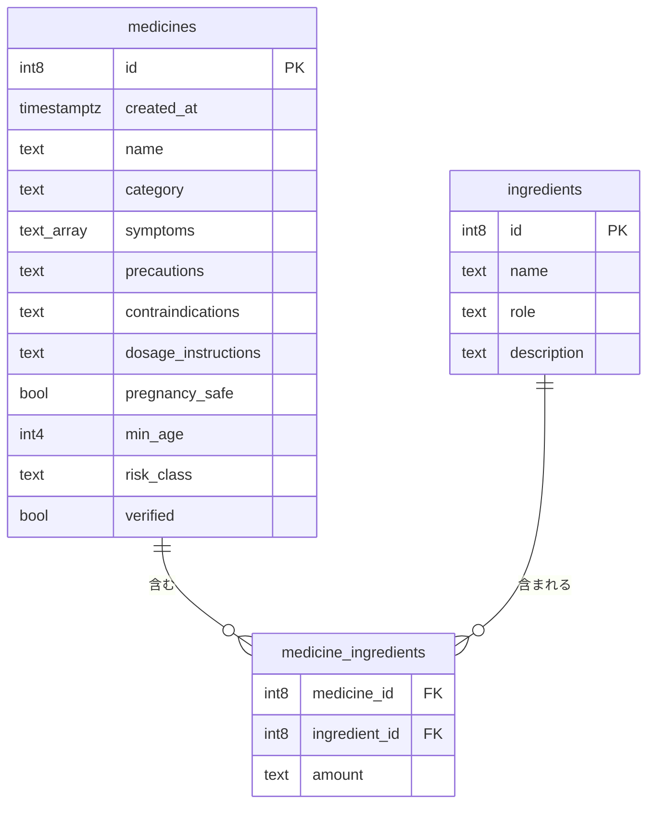

# データベース設計書（ER図・テーブル定義書）

最終更新: 2026-11-01

## 1. 使っているデータベース

| 項目 | 内容 |
|---|---|
| サービス | Supabase（中身は PostgreSQL） |
| テーブル数 | 3（`medicines`、`ingredients`、`medicine_ingredients`） |
| アプリから使っているテーブル | `medicines` だけ（ほかの2つはデータ投入済み。画面への表示はこれから） |

## 2. ER図

### つながりの読み方

- 1つの薬には、**たくさんの成分**が入っている（例: 1つの風邪薬に、解熱成分・鼻水を止める成分…）
- 1つの成分は、**たくさんの薬**に使われている（例: アセトアミノフェンは、いろいろな薬に入っている）
- このような「たくさん対たくさん」（多対多）の関係は、2つのテーブルを直接つなげず、**間に中間テーブル**（`medicine_ingredients`）を置いて表す

## 3. テーブル定義

### medicines（薬）

| 列名 | 型 | null | 説明 | 例 |
|---|---|---|---|---|
| `id` | int8 | 不可 | 薬の番号（主キー＝1冊ごとに違う背番号） | 1 |
| `created_at` | timestamptz | 不可 | 登録した日時（自動） | 2026-09-23 14:05 |
| `name` | text | 不可 | 薬の名前 | バファリンA |
| `category` | text | **可** | 分類（西洋薬／漢方／栄養ドリンク、または解熱鎮痛薬などの薬効分類） | 解熱鎮痛薬 |
| `symptoms` | text[]（文字の配列） | 不可 | 効く症状のリスト | ["頭痛","発熱","生理痛"] |
| `precautions` | text | 可 | 軽い注意点 | 空腹時の服用は避けてください |
| `contraindications` | text | 可 | 使用禁忌（絶対に使ってはいけない条件） | 胃潰瘍のある方は使用しないでください |
| `dosage_instructions` | text | 可 | 用法用量 | 1回1〜2錠、1日3回まで |
| `pregnancy_safe` | bool | 可 | 妊娠中に使えるか | false |
| `min_age` | int4 | 可 | 使える最低年齢 | 15 |
| `risk_class` | text | 可 | リスク区分（指定第2類／第2類／第3類／指定医薬部外品のどれか） | 指定第2類 |
| `verified` | bool | 不可（初期値 false） | 添付文書（PMDA）で確認済みか。**画面には出さない**、作る人向けの印 | false |

**メモ:**
- `symptoms` は配列型。Supabase の画面では「Define as Array」にチェックして作る。行を追加するときは `["頭痛","発熱"]` のように JSON の形で入力する
- null 可の列は、アプリの型（TypeScript）でも `string | null` のように **null を含めて書く**
- 「null 可/不可」は Obsidian の設計メモと実データから整理したもの。Supabase の画面の設定と食い違いがないか、一度確認する
- `risk_class` には `check` 制約（入れてよい値の決まり）を付けている。**第1類を入れようとするとエラーで弾かれる**ので、データベース自身が「第1類は扱わない」というルールを守る

### ingredients（成分マスタ）

| 列名 | 型 | null | 説明 | 例 |
|---|---|---|---|---|
| `id` | int8 | 不可 | 成分の番号（主キー） | 1 |
| `name` | text | 不可 | 成分の名前 | アセトアミノフェン |
| `role` | text | 可 | 役割 | 解熱・鎮痛 |
| `description` | text | 可 | 特徴 | 胃にやさしいとされる |

**成分を薬のテーブルに直接書かない理由:** 成分の役割は、どの薬に入っていても変わらない。薬ごとに書くと、同じ説明を何度も書くことになり、直すときに全部直す必要がある。

### medicine_ingredients（薬と成分の中間テーブル）

| 列名 | 型 | null | 説明 | 例 |
|---|---|---|---|---|
| `medicine_id` | int8 | 不可 | どの薬か（`medicines.id` を参照する外部キー） | 1 |
| `ingredient_id` | int8 | 不可 | どの成分か（`ingredients.id` を参照する外部キー） | 1 |
| `amount` | text | 可 | 配合量 | 660mg |

**メモ:**
- 外部キー（foreign key）とは、「ほかのテーブルにある番号しか入れられない」という決まり。存在しない `ingredient_id` を入れると、エラーで弾かれることを確認済み
- `amount` を数字ではなく文字（text）にしたのは、今は表示するだけで計算しないから。「660mg」をそのまま保存する

## 4. 設計で決めたこと

| テーマ | 決めたこと | 理由 |
|---|---|---|
| アレルギー対応 | 新しいテーブルは作らない | `medicine_ingredients` を通して「この成分を含む薬」を除外すればよい |
| 漢方・栄養ドリンク | `category` の列だけ用意 | 専用の検索ロジックは、v1 完成後の後回し |
| 併用禁忌（飲み合わせ） | 薬×薬の表は作らない。代わりに「**同じ成分の重ね飲み注意**」を出す（予定） | 薬×薬の表は、自分自身とのつながりでテーブルが複雑になり、医療的に誤った情報を出すリスクがあって専門家の監修が必要。「同じ成分が入っている」は事実なので誤情報のリスクが低く、`medicine_ingredients` で同じ `ingredient_id` を持つ薬を探すだけで出せる（例: かぜ薬と頭痛薬のアセトアミノフェン重複） |
| 扱う薬の範囲 | 第2類・第3類（指定第2類を含む）と指定医薬部外品だけ。**第1類は扱わない** | 第1類は薬剤師しか販売・説明できない。作成者（登録販売者）が説明できる範囲に合わせた |
| データの正しさ | 全件に `verified`（確認済みの印）を付け、初期値は false。添付文書（PMDA）と見比べて確認したものから true にする | 医療情報なので、確認前のデータと確認済みのデータを区別できるようにする |
| 自信のない値 | 配合量・用法用量・妊娠中の可否は null のまま入れる | 推測で埋めるより、空のほうが安全 |
| データの入れ方 | SQL ファイル（`otc-navi-api/db/`）で入れる | 画面から1件ずつ入れるより速く、何を入れたかが GitHub に残る |

## 5. テストデータ

### 件数（2026-11-01 時点）

| テーブル | 件数 |
|---|---|
| `medicines` | 35 |
| `ingredients` | 66 |
| `medicine_ingredients` | 78 |

### カテゴリ別の薬

成分パターンが違う薬を、カテゴリごとに選んでいる。

| category | 件数 | 主な成分パターン |
|---|---|---|
| 解熱鎮痛薬 | 4 | アスピリン／アセトアミノフェン単独／イブプロフェン／ACE処方 |
| かぜ薬（のど・鼻） | 4 | 総合かぜ薬／漢方（葛根湯）／トラネキサム酸／第1世代抗ヒスタミン＋血管収縮 |
| 胃腸薬 | 4 | 制酸・健胃（生薬）／胃粘膜修復＋消化酵素／鎮痙（抗コリン）／漢方 |
| アレルギー用薬 | 4 | 第2世代抗ヒスタミン×2／第1世代抗ヒスタミン／点鼻ステロイド |
| 整腸・下痢・便秘薬 | 3 | 止瀉／刺激性下剤／塩類下剤（新ビオフェルミンは category が NULL） |
| 目薬 | 4 | 一般点眼／抗アレルギー／抗菌（サルファ剤）／人工涙液 |
| 外用鎮痛消炎薬 | 4 | ジクロフェナク／ロキソプロフェン／フェルビナク／サリチル酸メチル |
| 塗り薬 | 7 | ステロイド（strong・medium・weak）／ステロイドなしのかゆみ止め／水虫（テルビナフィン・ブテナフィン・ラノコナゾール） |
| NULL | 1 | 新ビオフェルミン（null 対策のテスト用。整腸のビフィズス菌など） |

### 入れたときの SQL ファイル

| ファイル | 内容 |
|---|---|
| `01_add_columns.sql` | `risk_class`・`verified` の列を追加 |
| `02_seed.sql` | 薬26件・成分55件・つながり62行を追加、既存2件にリスク区分を入れる |
| `03_add_topical_analgesics.sql` | 外用鎮痛消炎薬（新規3件、ボルタレンEXゲルを塗り薬から移動） |
| `04_add_itch_and_athletes_foot.sql` | かゆみ止め2件・水虫薬2件 |

SQL ファイルの工夫:
- 番号（id）ではなく名前で指定し、番号はデータベースに探させる（番号の書き間違いで別の薬につながるのを防ぐ）
- `where not exists` で、2回実行しても二重に入らない
- `begin` 〜 `commit` で囲み、途中でエラーが出たら全部取り消す

### データの修正記録

| 日付 | 内容 |
|---|---|
| 2026-11-01 | テーブル作成時に試しに入れた「バファリンA × アセトアミノフェン」の行を削除（バファリンAの主な成分はアスピリン）。件数が想定より1行多かったことから発見した |
