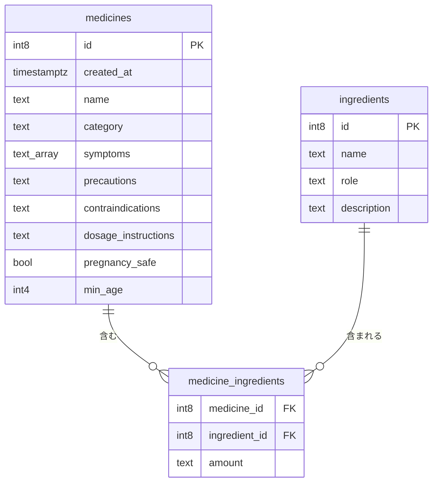

# データベース設計書（ER図・テーブル定義書）

最終更新: 2026-10-16

## 1. 使っているデータベース

| 項目 | 内容 |
|---|---|
| サービス | Supabase（中身は PostgreSQL） |
| テーブル数 | 3（`medicines`、`ingredients`、`medicine_ingredients`） |
| アプリから使っているテーブル | `medicines` だけ（ほかの2つは作成済みで、これから使う） |

## 2. ER図

### つながりの読み方

- 1つの薬には、**たくさんの成分**が入っている（例: 1つの風邪薬に、解熱成分・鼻水を止める成分…）
- 1つの成分は、**たくさんの薬**に使われている（例: アセトアミノフェンは、いろいろな薬に入っている）
- このような「たくさん対たくさん」（多対多）の関係は、2つのテーブルを直接つなげず、**間に中間テーブル**（`medicine_ingredients`）を置いて表す

## 3. テーブル定義

### medicines（薬）

| 列名 | 型 | null | 説明 | 例 |
|---|---|---|---|---|
| `id` | int8 | 不可 | 薬の番号（主キー＝1冊ごとに違う背番号） | 1 |
| `created_at` | timestamptz | 不可 | 登録した日時（自動） | 2026-09-23 14:05 |
| `name` | text | 不可 | 薬の名前 | バファリンA |
| `category` | text | **可** | 分類（西洋薬／漢方／栄養ドリンク、または解熱鎮痛薬などの薬効分類） | 解熱鎮痛薬 |
| `symptoms` | text[]（文字の配列） | 不可 | 効く症状のリスト | ["頭痛","発熱","生理痛"] |
| `precautions` | text | 可 | 軽い注意点 | 空腹時の服用は避けてください |
| `contraindications` | text | 可 | 使用禁忌（絶対に使ってはいけない条件） | 胃潰瘍のある方は使用しないでください |
| `dosage_instructions` | text | 可 | 用法用量 | 1回1〜2錠、1日3回まで |
| `pregnancy_safe` | bool | 可 | 妊娠中に使えるか | false |
| `min_age` | int4 | 可 | 使える最低年齢 | 15 |

**メモ:**
- `symptoms` は配列型。Supabase の画面では「Define as Array」にチェックして作る。行を追加するときは `["頭痛","発熱"]` のように JSON の形で入力する
- null 可の列は、アプリの型（TypeScript）でも `string | null` のように **null を含めて書く**
- 「null 可/不可」は Obsidian の設計メモと実データから整理したもの。Supabase の画面の設定と食い違いがないか、一度確認する

### ingredients（成分マスタ）

| 列名 | 型 | null | 説明 | 例 |
|---|---|---|---|---|
| `id` | int8 | 不可 | 成分の番号（主キー） | 1 |
| `name` | text | 不可 | 成分の名前 | アセトアミノフェン |
| `role` | text | 可 | 役割 | 解熱・鎮痛 |
| `description` | text | 可 | 特徴 | 胃にやさしいとされる |

**成分を薬のテーブルに直接書かない理由:** 成分の役割は、どの薬に入っていても変わらない。薬ごとに書くと、同じ説明を何度も書くことになり、直すときに全部直す必要がある。

### medicine_ingredients（薬と成分の中間テーブル）

| 列名 | 型 | null | 説明 | 例 |
|---|---|---|---|---|
| `medicine_id` | int8 | 不可 | どの薬か（`medicines.id` を参照する外部キー） | 1 |
| `ingredient_id` | int8 | 不可 | どの成分か（`ingredients.id` を参照する外部キー） | 1 |
| `amount` | text | 可 | 配合量 | 660mg |

**メモ:**
- 外部キー（foreign key）とは、「ほかのテーブルにある番号しか入れられない」という決まり。存在しない `ingredient_id` を入れると、エラーで弾かれることを確認済み
- `amount` を数字ではなく文字（text）にしたのは、今は表示するだけで計算しないから。「660mg」をそのまま保存する

## 4. 設計で決めたこと

| テーマ | 決めたこと | 理由 |
|---|---|---|
| アレルギー対応 | 新しいテーブルは作らない | `medicine_ingredients` を通して「この成分を含む薬」を除外すればよい |
| 漢方・栄養ドリンク | `category` の列だけ用意 | 専用の検索ロジックは、v1 完成後の後回し |
| 併用禁忌（飲み合わせ） | 作らない | 薬×薬の自分自身とのつながりでテーブルが複雑になる。医療的に誤った情報を出すリスクがあり、専門家の監修が必要 |

## 5. テストデータ

| id | name | category | symptoms |
|---|---|---|---|
| 1 | バファリンA | 解熱鎮痛薬 | 頭痛、発熱、生理痛 |
| 2 | 新ビオフェルミン | NULL（null 対策のテスト用） | 便秘、下痢 |
